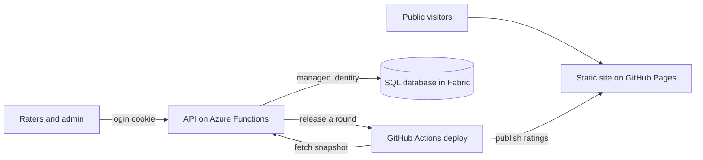

In April 1909, John Moody published *Moody's Analyses of Railroad Investments*. Robin Wigglesworth tells the story in *A Fabulous Debt*, and the innovation that set Moody's book apart from its predecessors was "a simple, letter-based grading system that judged the 'factor of safety' for each of the nearly thirteen hundred bonds detailed inside."

There were eleven grades, from a rock-solid Aaa to a lowly E, and almost 39 percent of the railroad bonds got the top one. The notches have changed since, but anything in the top half of the scale is still considered investment grade and relatively safe. "Below that there be dragons, was the implicit message."

Then the passage that stuck with me:

> Ratings are convenient. In the words of David Beers, who led S&P's government ratings business in the 1990s and 2000s, the letters provide a "common language of credit risk."

Wigglesworth argues that common language "was unquestionably a major factor behind the bond market's dramatic growth in the twentieth century."

Microsoft Fabric has more than 75 items now, and people keep asking me the same questions about them. When should I use notebooks? Should I use notebooks at all? Dataflows or pipelines? Is Datamart still a thing? Fabric needed a common language too, so I built one.

[Fabric Credit Ratings](https://fabriccreditratings.com) gives Fabric items a bond-style letter grade, AAA through C, with D for anything Microsoft has retired. AAA is the best of the best, and the risk goes up as the letters go down. A grade tells you how good an investment an item is for your time and your company's capacity.

## Why I built it

Fabric changes every month. New items land in preview and old ones get retired, while AI keeps changing how we build on top of all of it. Keeping up is a full-time job, and most people building on Fabric already have one.

The people who do keep up, MVPs and consultants who build on Fabric every day, share what they know in pieces: a conference session here, a LinkedIn post there. I wanted it written down in one public place, where anyone in the community can see what we think of every item and why. It's independent and unofficial, and it's free. Use a grade as a fast starting point on where to spend your time and capacity, then do your own testing.

The plan is to update the ratings once a quarter. Each round keeps the old grade in the item's history, next to a note explaining it, so over time you can watch an item climb or slide. I don't expect most grades to move fast. They should move when something major ships or an item gets a lot better.

That's why outlook is one of the four factors, and it's the one I'd read first when you're picking something for new work. Whatever you build on Fabric this year, you'll be maintaining for years. Dataflow Gen1 is BBB+ today, with a 5.5 for capability and a 6 for user experience. Its outlook is a 2. It runs fine now, and the raters don't think it has much of a future. Copilot in Fabric goes the other way: capability and user experience both score a 2, and outlook gets a 4.5 because the raters expect it to improve. Rating agencies put an outlook next to a bond's rating for the same reason. It tells you which way the grade is likely to move.

This only works if enough people who know Fabric are scoring it. If you're a Microsoft MVP and want to rate items, [message me on LinkedIn](https://www.linkedin.com/in/tommypuglia/) and I'll set you up with a login.

## What the site rates


The ratings come from me and other MVPs. Each rater scores an item from 1 to 7 on four factors:

- **Feature Capability:** what it can do, and how complete it is.
- **User Experience:** how easy it is to build with, debug, and operate.
- **CU / Token Cost:** how many capacity units or tokens the work costs.
- **Outlook:** where it's headed over the next year.

The averaged scores, along with things like release status and reliability, set the grade. Grades fall into bands, the same way bonds do:

- **Investment grade (AAA to A-):** does its job well. You can build on it.
- **Low investment grade (BBB+ to BBB-):** does the job today, with rough edges or costs to budget for.
- **Speculative (BB+ to B-):** usable, with gaps you should plan around.
- **Distressed (CCC to C):** falling behind, or the wrong tool for new work.
- **Deprecated (D):** retired.

As of the Q4 2026 round on October 19, 58 items across 12 workloads have a grade. 44 of them land in the two investment bands, and the median is BBB+.


Some grades will surprise nobody. Pipelines, lakehouses, and semantic models are AA+, and notebooks are AA-. Dataflow Gen1 (BBB+) rates above Dataflow Gen2 (BBB-), which didn't surprise me either. Dashboards got a B-, the last notch before distressed, and I think that's fair. How many people are still building dashboards? Datamart is a D.


If none of us felt qualified to score an item, it doesn't have a grade yet.

## Score the workstream

I've also been reading *Fatal Risk*, Roddy Boyd's book on the rise and fall of AIG. AIG sorted its practices into four buckets: preferred, accepted, discouraged, and unacceptable. PADU. The book's example is customer statements. Quarterly statements online with no paper were preferred, and online statements plus a printed annual report were accepted. Defaulting customers to paper was discouraged. Print-only was unacceptable.

Preferred wasn't mandatory. Unacceptable meant you stopped, and a team that kept doing it was looking at a firing offense.

Here's how I'd define the rungs for a Fabric team:

- **Preferred** is the recommended way. You can't force it on anyone, but it's where people get hired and promoted.
- **Accepted** is fine. Nobody makes a stink about it.
- **Discouraged** means we noticed, we wrote it down, and we're going to talk about moving you off it.
- **Unacceptable** is tomorrow's priority.

Microsoft's docs show workflows without saying which ones to avoid. We're three years into Fabric, and we've seen enough to say.

The catch is that you can't put a Fabric item in one bucket and walk away. A SQL database in Fabric is preferred when I'm building an application that has to talk to other systems. For analytics, it's accepted. It works, and it isn't what I'd reach for first.


On Fabric Credit Ratings, SQL database is an A-. Feature capability and user experience score 5.5 each, and outlook scores a 6. CU cost scores a 3, because it "draws on CUs even when activity is light, which makes it a pricier way to host small or intermittent workloads."

The grade tells you where an item is weak. Your workstream tells you whether that weakness matters. Paginated reports are BBB- on the site, and on my team they're discouraged unless you're sending invoices, emailing output, or automating delivery. For that job, the site's own note calls them the right tool for pixel-perfect invoices. Same item, two buckets.

Bond investors already work this way. A credit rating measures how likely the issuer is to pay you back. Whether that bond belongs in your portfolio is your call. Fabric Credit Ratings is the shared letter, and your PADU list is the portfolio.

One more thing on cost. CU cost is one factor of four. If CUs are the only thing you watch, you'll build a cheap platform nobody trusts. For me, trust in the data and a process other teams can repeat weigh at least as much as the capacity bill.

## How I built it

I always want Fabric as the backend. I've argued that [Fabric is best as a backend](/2026/10/05/fabric-is-best-as-a-backend/), and Fabric Credit Ratings is me doing it. Three requirements shaped the design:

1. Public page views shouldn't cost capacity. A public site that reads the database on every visit burns CUs for every visitor, and my own site gives SQL database a 3 on cost.
2. Raters shouldn't need an account in my tenant. If another MVP wants to submit ratings, I create a login for them, and they never become a user in my Microsoft tenant.
3. Scores shouldn't change every time someone submits. Grades move when I release a round.

So the site has two halves:



The public half is a static React site on GitHub Pages. The ratings are a JSON snapshot built into the pages at deploy time, so visitors never call the API and never touch Fabric. Pages load fast and cost zero CUs. If I pause the capacity, the site keeps serving the last published ratings. GitHub also gives me source control on every release.

The rater half is `/rate` and `/admin`. Those pages call a small API on Azure Functions (Flex Consumption, Node, TypeScript). The functions are anonymous at the platform level because the app runs its own logins. I create usernames and passwords in the admin page, and sessions live in the database behind an HttpOnly cookie. The API connects to the SQL database in Fabric with the Function App's managed identity, so there's no database password anywhere.

When a round closes, I review the averaged scores and write the "why" note for each item. An AI button drafts the first pass, and I edit it. Then I hit publish. The API starts a GitHub Actions deploy that pulls one fresh snapshot, builds the site, and publishes it. The public site updates in about two minutes.

The tradeoff is the first API call after a quiet spell, which can take up to a minute while the database wakes up. Raters hit that now and then. Public visitors never do.

The whole thing took about a week of iterations with an agent. Without the agent, it wouldn't exist.

## Build your own

Here's the infrastructure, roughly in setup order. Once these decisions are made, an agent can write the code.

1. **A SQL database in Fabric** on an F SKU capacity, plus a second one for dev. Keep the schema in a SQL file in your repo, written so you can rerun it safely.
2. **An API host with a managed identity.** I used Azure Functions on Flex Consumption. Turn on the system-assigned managed identity.
3. **Fabric access for that identity.** Enable the "Service principals can use Fabric APIs" tenant setting for a security group that contains it, and share the database item with it (Read, nothing extra). Then add it as a database user:

```sql
CREATE USER [your-function-app] FROM EXTERNAL PROVIDER;
ALTER ROLE db_datareader ADD MEMBER [your-function-app];
ALTER ROLE db_datawriter ADD MEMBER [your-function-app];
```

4. **Your own users table** if contributors live outside your tenant: hashed passwords, a sessions table, login lockout, and CSRF protection. The admin creates every account, and there's no self-signup.
5. **A static front end** that reads a snapshot file at build time. Public pages never call the API.
6. **A deploy workflow** that fetches the snapshot with a token, builds, publishes, and tells the API which snapshot went live. A fine-grained GitHub token lets the API start that workflow when you publish.
7. **CORS on the Function App.** The Azure Functions host answers every preflight `OPTIONS` request before your code runs. List your site's origins in the platform CORS settings with credentials enabled, or the browser blocks every POST.
8. **Server-only logic on the server.** My grade formula lives in the API, and CI fails the build if it ever shows up in the published site.

## Why I like building on Fabric

A side project like this used to mean a separate database with its own bill and its own security model, sitting outside everything else I run. Now the database lives in a capacity I already pay for, in the same tenant as my lakehouses and semantic models. SQL database in Fabric also mirrors to OneLake on its own, so every rating and every round is already there for analytics without a pipeline.

The other route is a Fabric App. If your contributors don't need to log in at all, [anonymous access in Fabric Apps](/2026/10/14/anonymous-access-fabric-apps/) lets them write straight into the app's SQL database, which is how Fabric Quest works. The auth config in Rayfin, the SDK behind Fabric Apps, also lists a password method for people outside your tenant. That's the job my Azure Functions layer does today. My prediction: the next version of Fabric Credit Ratings runs as a Fabric App, with no separate API to host.

Go look at [fabriccreditratings.com](https://fabriccreditratings.com). Find the items your team uses and tell me where you think we're wrong. If you're an MVP who works in real-time intelligence or data science, [message me on LinkedIn](https://www.linkedin.com/in/tommypuglia/). Those workloads need more raters.

## Takeaways

- A letter grade gives everyone a common language for Fabric items. Fabric Credit Ratings grades 58 of them, AAA to D, and updates every quarter with history.
- Read the outlook before you start new work on an item. Dataflow Gen1 is BBB+ today with an outlook of 2.
- Bucket each item for your own workstream: preferred, accepted, discouraged, or unacceptable. SQL database is preferred for apps and accepted for analytics.
- When an item's weak factor matters to you, design around it. Fabric Credit Ratings keeps every public visitor off its SQL database with a static snapshot.
- Fabric works as an app backend today: a SQL database, a managed identity, a small API, and a static site.

**Key takeaway:** this week, look up the grades for the three Fabric items your team uses most, then write down whether each one is preferred, accepted, discouraged, or unacceptable for your main workstream.

Keep the conversation going with us on the Explicit Measures podcast, and subscribe at PromptingBI for more. And remember: below BBB-, there be dragons.
